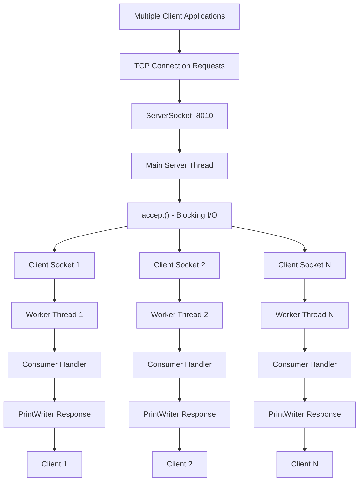
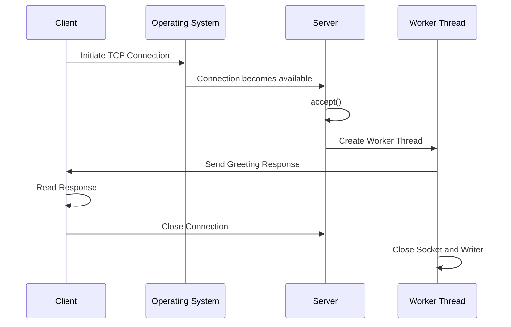
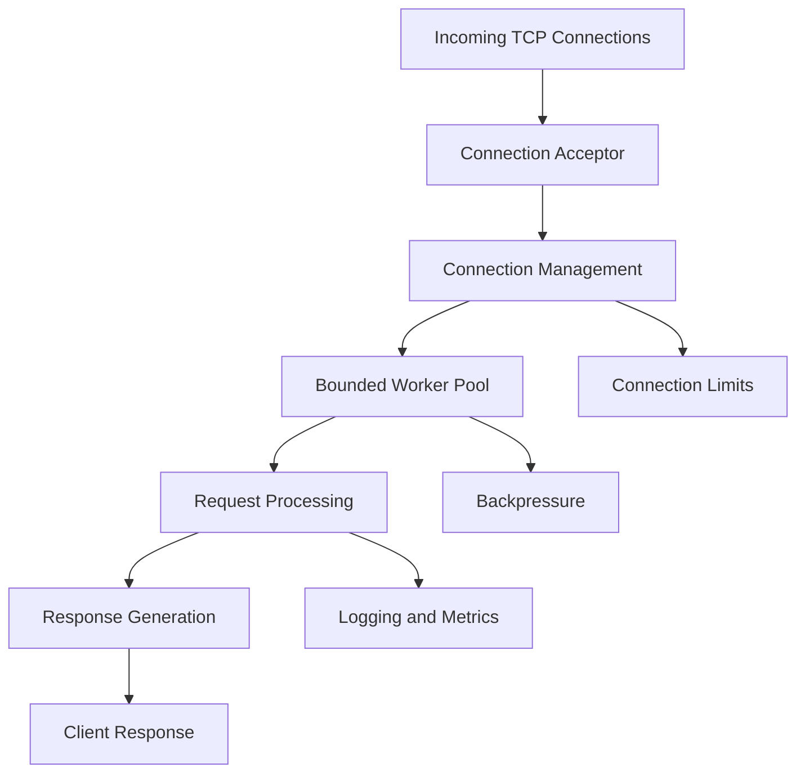

# ⚡ High-Performance Multithreaded TCP Server in Java

### Low-Level Network Programming | Concurrent Connection Handling | Performance Benchmarking

<p align="center">
  
  
  
  
</p>

<p align="center">
  <b>Built from scratch using Core Java, TCP Sockets, Java Threads, and Apache JMeter.</b>
</p>

---

## 📌 Project Overview

This project implements a **multithreaded TCP server from scratch using Core Java**, demonstrating how network servers establish connections, handle multiple clients concurrently, manage I/O resources, and respond to incoming communication requests.

Instead of relying on high-level backend frameworks such as Spring Boot, Netty, or external application servers, the implementation uses Java's native networking APIs, including `ServerSocket` and `Socket`, to understand the underlying mechanics of client-server communication.

The server listens on port `8010`, continuously accepts incoming TCP connections, and delegates each accepted connection to an independent worker thread using a **Thread-per-Connection architecture**.

The repository also includes:

- A multithreaded Java client simulator for generating concurrent connections.
- A functional connection handler implemented using Java's `Consumer<Socket>` interface and lambda expressions.
- Resource-safe socket handling using Java's try-with-resources mechanism.
- An Apache JMeter test suite for load testing and performance evaluation.

### 🎯 Engineering Objectives

- Understand TCP/IP networking and socket-level communication.
- Implement concurrent client handling using Java multithreading.
- Explore blocking I/O and thread lifecycle management.
- Understand the relationship between concurrency, throughput, and latency.
- Practice resource management in network applications.
- Evaluate server performance through load testing.
- Understand the scalability trade-offs of thread-per-connection architectures.

---

## 🏗️ System Architecture

The server follows a **Thread-per-Connection concurrency model**.

A single main server thread continuously listens for incoming connections. Whenever a client connects, the server accepts the connection and creates a dedicated worker thread to process that client independently.

### High-Level Architecture



### Architecture Components

| Component | Responsibility |
|---|---|
| Client | Initiates TCP connections |
| ServerSocket | Listens for incoming TCP connections |
| Main Server Thread | Accepts incoming connections |
| `accept()` | Blocks until a connection is established |
| Socket | Represents an established client connection |
| Worker Thread | Processes an individual client connection |
| Consumer | Encapsulates connection-handling logic |
| PrintWriter | Sends text-based responses |
| Apache JMeter | Generates load and collects performance measurements |

---

## 🔄 Internal Working: Connection Lifecycle

Understanding the lifecycle of a client connection is central to understanding this implementation.

### 1. Server Initialization

The server initializes a `ServerSocket` on port `8010`.

```java
ServerSocket serverSocket = new ServerSocket(8010);
```

**What happens internally?**

- A server-side TCP listening socket is created.
- The socket is bound to the specified port.
- The operating system manages incoming connection requests.
- The server becomes ready to accept client connections.

`ServerSocket` is responsible for accepting connections, not directly exchanging application data with clients.

### 2. Accepting Incoming Connections

```java
while (true) {
    Socket clientSocket = serverSocket.accept();
}
```

The server continuously waits for incoming connections.

**Understanding `accept()`:**

- It is a blocking operation.
- The calling thread waits until a client establishes a connection.
- It returns a new `Socket` representing the established connection.
- The returned socket is used for communication with that particular client.

An important distinction: `accept()` blocks the main server thread, but the worker threads created for previously accepted connections can continue executing independently.

### 3. Creating Independent Worker Threads

```java
Thread thread = new Thread(
    () -> server.getConsumer().accept(clientSocket)
);

thread.start();
```

After accepting a connection, the server creates a new worker thread.

Each worker executes the connection handler independently.

**Why use multithreading?**

Consider three clients connecting simultaneously:

```text
Client A ───────> Worker Thread 1
Client B ───────> Worker Thread 2
Client C ───────> Worker Thread 3
```

Each worker manages its own client connection.

If one worker is waiting on a blocking operation, it does not directly stop other worker threads from executing.

This improves concurrency compared with processing all client connections sequentially in a single thread.

### 4. Connection Handling with Consumer and Lambda Expressions

The server uses Java's functional programming capabilities to encapsulate client-handling logic.

```java
public Consumer<Socket> getConsumer() {
    return (clientSocket) -> {
        try (
            Socket socket = clientSocket;
            PrintWriter writer =
                new PrintWriter(socket.getOutputStream(), true)
        ) {
            writer.println(
                "Hello from server " + socket.getInetAddress()
            );

        } catch (IOException ex) {
            System.err.println(
                "Client handler exception: " + ex.getMessage()
            );
        }
    };
}
```

**Understanding the implementation:**

- `Consumer<Socket>` is a functional interface.
- It accepts a Socket as input and does not return a value.
- The lambda expression provides the implementation of the `accept()` method.
- `getOutputStream()` provides the output stream associated with the client connection.
- `PrintWriter` makes it convenient to send text.
- `println()` sends a newline-terminated response.

The connection handler is responsible for processing an individual client's communication.

### 5. Resource Management with Try-with-Resources

```java
try (
    Socket socket = clientSocket;
    PrintWriter writer =
        new PrintWriter(socket.getOutputStream(), true)
) {
    writer.println("Hello from server");
}
```

Network resources must be released properly.

The implementation uses Java's try-with-resources statement to automatically close the declared resources when the block finishes.

**Why does this matter?**

- Prevents sockets from remaining open unnecessarily.
- Reduces the risk of resource leaks.
- Simplifies cleanup logic.
- Ensures resources are closed even when an exception occurs.

`PrintWriter` does not throw `IOException` from its normal write methods; its error status can be checked using `checkError()` when write-failure detection is required.

---

## 🌐 TCP Networking Fundamentals

This project provides practical experience with fundamental networking concepts.

| Concept | Meaning |
|---|---|
| TCP | Connection-oriented transport protocol providing reliable, ordered byte-stream delivery |
| IP Address | Identifies a host on an IP network |
| Port | Identifies a communication endpoint on a host |
| Socket | Communication endpoint used by network applications |
| ServerSocket | Listens for incoming TCP connection requests |
| `accept()` | Accepts an incoming connection |
| Blocking I/O | An operation that waits for an I/O event |
| InputStream | Reads incoming bytes |
| OutputStream | Writes outgoing bytes |
| Connection Lifecycle | Connection establishment, communication, and termination |

### TCP Connection Sequence



**Important networking detail:** TCP provides a continuous stream of bytes rather than independent application messages. This implementation uses a newline-terminated text response, which can be read using a line-oriented client reader.

---

## 🧵 Concurrency Model and Multithreading

### Thread-per-Connection Architecture

The current implementation assigns one dedicated Java worker thread to every accepted client connection.

```text
Incoming TCP Connection
          |
          v
     accept()
          |
          v
   Create Worker Thread
          |
          v
    Handle Client I/O
          |
          v
    Send Response
          |
          v
    Close Connection
```

### Advantages

- Independent client connection handling.
- Concurrent execution of multiple connection handlers.
- Simple architecture and implementation.
- Blocking I/O in one worker does not directly block other workers.

### Engineering Trade-offs

Thread-per-connection is simple and useful for learning, but unrestricted thread creation has scalability limitations.

Every thread introduces memory and scheduling overhead.

Under heavy connection loads, this can result in:

- Increased memory consumption.
- Operating-system context-switching overhead.
- Thread scheduling contention.
- Resource exhaustion.
- Reduced performance at high concurrency.

### Alternative Architectures

| Architecture | Working Principle | Main Benefit |
|---|---|---|
| Thread-per-Connection | One thread per connection | Simple concurrency model |
| Thread Pool | Reuses a bounded set of worker threads | Controlled resource usage |
| Java NIO | Non-blocking channel-based I/O | Efficient I/O management |
| Selector-Based Server | Monitors multiple channels through an event loop | Handles many connections with fewer threads |

These alternatives are potential improvements and are not part of the current implementation.

---

## 🖥️ Multithreaded Java Client Simulator

The repository includes a separate Java client simulator that creates multiple concurrent client connections.

Its purpose is to validate that the server can accept and process multiple independent TCP connections.

### Client Execution Logic

```java
public static void main(String[] args) {

    Client client = new Client();

    int clientCount = 100;

    System.out.println(
        "[+] Launching " + clientCount +
        " parallel client threads..."
    );

    for (int i = 0; i < clientCount; i++) {
        Thread thread =
            new Thread(client.getRunnable());

        thread.start();
    }
}
```

### Execution Flow

1. Initialize the client simulator.
2. Create 100 client threads.
3. Each thread initiates a TCP socket connection.
4. Connect to the server on port `8010`.
5. Read the response from the server.
6. Display the received response.
7. Close the connection and associated resources.

This provides a practical demonstration of concurrent TCP client-server communication.

---

## 📊 Apache JMeter: Load Testing and Performance Analysis

Apache JMeter is used to evaluate server performance under simulated concurrent load.

The repository contains preconfigured JMeter test plans for executing load tests in GUI and command-line modes.

### 🚀 Benchmark Results

The following figures represent recorded results from the project's benchmark runs.

| Metric | Recorded Result | Interpretation |
|---|---:|---|
| Peak Throughput | **23,180.2 requests/sec** | Highest recorded processing rate |
| Total Requests Handled | **1,024,287** | More than one million recorded requests |
| Average Response Latency | **15 ms** | Recorded average response time |
| Minimum Response Latency | **0 ms** | Minimum reported measurement |
| Reported Error Rate | **0.00%** | No errors reported in the recorded test |

### Understanding Performance Metrics

**1. Throughput**

Throughput measures the number of completed requests within a given time interval.

```text
Throughput = Completed Requests / Time
```

Example:

```text
10,000 requests per second
```

This means that approximately 10,000 requests were completed per second during the measured interval.

**2. Latency**

Latency measures the time taken to complete an operation.

Lower latency generally indicates faster response times.

**3. Error Rate**

Error rate measures the proportion of failed requests.

```text
Error Rate =
(Failed Requests / Total Requests) × 100
```

A reported error rate of 0.00% means that no errors were recorded in the corresponding test results.

**4. Concurrency**

Concurrency describes how many operations or connections are active during overlapping periods.

Concurrency is not equivalent to throughput.

A system can maintain many concurrent connections without completing the same number of requests per second.

### Running JMeter Tests

**CLI Mode — Recommended for Benchmarking**

```bash
jmeter -n -t web_server_testing.jmx -l test_results.jtl
```

**GUI Mode — Recommended for Visual Inspection**

```bash
jmeter -t web_server_testing.jmx
```

Useful JMeter listeners:

- Aggregate Report
- Summary Report
- View Results Tree
- View Results in Table

### Benchmarking Considerations

Performance results depend on several environmental factors:

- CPU and RAM specifications.
- Operating system and available resources.
- JVM version and runtime configuration.
- Number of JMeter threads.
- Ramp-up period and test duration.
- Network conditions.
- Connection reuse and test-plan configuration.

The recorded results should be treated as measurements from a particular test environment, not guaranteed production capacity.

---

## ⚙️ Technology Stack

| Technology | Purpose |
|---|---|
| Java 17+ | Core programming language |
| Java Threads | Concurrent execution |
| `ServerSocket` | Server-side TCP connection listening |
| `Socket` | Client-server communication |
| Java I/O | Stream-based communication |
| Lambda Expressions | Functional connection-handler implementation |
| `Consumer<Socket>` | Encapsulation of connection-handling logic |
| Try-with-resources | Automatic resource management |
| Apache JMeter 5.6.3 | Load testing and performance evaluation |

**Design decision:** The implementation intentionally uses Core Java networking APIs rather than high-level web frameworks to expose the underlying connection-handling mechanics.

---

## 📁 Repository Structure

```text
Multithreaded-web-server/
│
├── Server.java
│   └── TCP server initialization,
│       connection listener and worker thread creation
│
├── Client.java
│   └── Multithreaded client simulator
│
├── web_server_testing.jmx
│   └── Apache JMeter load-testing configuration
│
├── Thread Group.jmx
│   └── Additional JMeter test configuration
│
├── .gitignore
│   └── Git ignore rules
│
└── README.md
    └── Project documentation
```

---

## 🚀 Getting Started

### Prerequisites

- Java Development Kit (JDK 17 or higher).
- Git.
- Apache JMeter 5.6.3 or higher (optional, for load testing).

### 1. Clone the Repository

```bash
git clone https://github.com/Mayank1036/Multithreaded-web-server.git

cd Multithreaded-web-server
```

### 2. Compile the Java Source Files

```bash
javac Server.java Client.java
```

### 3. Start the Server

```bash
java Server
```

Expected output:

```text
[+] Server successfully listening on port 8010
[+] Awaiting incoming connections...
```

### 4. Start the Client Simulator

Open another terminal in the project directory.

```bash
java Client
```

The client simulator will launch its parallel client threads and print the server responses.

### 5. Execute Load Tests

With the server running:

```bash
jmeter -n -t web_server_testing.jmx -l test_results.jtl
```

---

## ⚠️ Current Scope and Limitations

This project focuses on TCP networking and concurrent connection handling. Despite the repository's web-server naming, the current implementation is a TCP server and does not implement the HTTP protocol.

Current limitations include:

- No HTTP request parsing or HTTP response status codes.
- No REST API endpoints or request routing.
- No bounded thread pool.
- No explicit maximum connection limit.
- No connection timeout or idle-connection management.
- No authentication or authorization.
- No structured logging or monitoring.
- No dedicated graceful shutdown mechanism.
- No production-grade error-handling or overload-management strategy.

Documenting these limitations is important because it distinguishes the implemented system from a production HTTP server.

---

## 🔮 Future Enhancements

The project can be evolved into a more scalable networking system through the following improvements.

| Enhancement | Engineering Concept |
|---|---|
| ExecutorService | Thread-pool management |
| Bounded Thread Pool | Resource control |
| Java NIO | Non-blocking I/O |
| Selector API | Event-driven networking |
| HTTP/1.1 Parser | HTTP protocol implementation |
| Connection Timeout | Connection lifecycle management |
| Graceful Shutdown | Controlled server termination |
| Structured Logging | Observability |
| Metrics Collection | Performance monitoring |
| Backpressure | Overload management |
| Docker | Containerization |

### Proposed Future Architecture



This is a proposed architectural evolution, not the current implementation.

---

## 🧠 Key Engineering Concepts Demonstrated

This project provides hands-on experience with:

- TCP/IP networking fundamentals.
- Client-server architecture.
- Java socket programming.
- Blocking I/O operations.
- Thread-per-connection architecture.
- Thread lifecycle and concurrent execution.
- Java functional interfaces and lambda expressions.
- Exception handling in network applications.
- Automatic resource management.
- Load testing and performance benchmarking.
- Throughput, latency, and error-rate analysis.
- Concurrency and scalability trade-offs.

---

## 👨‍💻 Author

**Mayank Saini**

B.Tech Computer Science Engineering | Artificial Intelligence & Data Science

Interested in Backend Engineering, Computer Networks, Distributed Systems, and High-Performance Software Engineering.

- GitHub: [Mayank1036](https://github.com/Mayank1036)
- LinkedIn: [Mayank Saini](https://www.linkedin.com/in/mayank-saini-4860a4210/)

---

<p align="center">
  <b>Understanding networking from the socket level, one connection at a time.</b>
</p>

<p align="center">
  ⭐ If you find this project useful, consider giving the repository a star!
</p>
