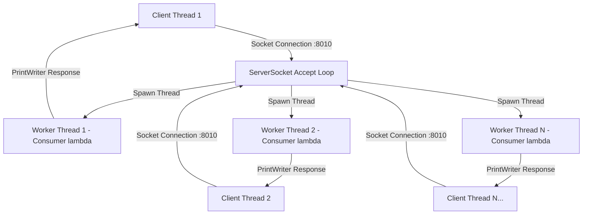

# ⚡ High-Performance MultiThreaded Java Web Server & Load Testing Suite

[](https://www.java.com/)
[](https://jmeter.apache.org/)
[](#license)

A high-concurrency, multi-threaded Web Server built from scratch in core Java using raw TCP Sockets, `ServerSocket`, and Java functional streams. This repository includes a multi-threaded Client simulator as well as an automated **Apache JMeter load testing strategy** capable of processing over **23,000 requests/second**.

---

## 📌 Architecture Overview



---

## ✨ Features

- **Multithreaded Architecture**: Listens for incoming connections on port `8010` and immediately spawns a dedicated worker thread using Java `Thread` lambdas.
- **Resource Management**: Implements modern Java `try-with-resources` to guarantee auto-closure of client sockets and `PrintWriter` output streams.
- **Custom Load Simulation**: Built-in `Client.java` utility to simulate parallel multi-threaded connections.
- **Benchmark Suite**: Pre-configured Apache JMeter Test Plan (`web_server_testing.jmx`) for end-to-end stress testing with live visual metrics.

---

## 📊 JMeter Benchmark & Performance Analysis

The server was benchmarked under real-time stress test conditions using **Apache JMeter (CLI & GUI mode)**.

### 🚀 **Benchmark Results Summary**

| Metric | Result | Analysis |
| :--- | :--- | :--- |
| **Peak Throughput** | **`23,180.2 requests / sec`** | High-performance request processing capability |
| **Total Requests Handled** | **`1,024,287 Requests`** | Stress-tested over 1+ Million TCP requests |
| **Average Response Latency** | **`15 ms`** | Ultra-low response latency under load |
| **Min Response Latency** | **`0 ms`** | Instantaneous connection handling |
| **Standard Load Accuracy** | **`0.00% Error Rate`** | 100% success rate under 1,000 connection bursts |

---

## 🚀 Getting Started

### Prerequisites

- **Java Development Kit (JDK 17 or higher)**
- **Apache JMeter 5.6.3+** (Optional, for running GUI/CLI benchmarks)

### 1️⃣ Clone the Repository

```bash
git clone https://github.com/Mayank1036/Multithreaded-web-server.git
cd Multithreaded-web-server
```

### 2️⃣ Compile the Source Files

```bash
javac Server.java Client.java
```

### 3️⃣ Run the Web Server

```bash
java Server
```

*Expected Output:*
```text
[+] Server successfully listening on port 8010
[+] Awaiting incoming connections...
```

### 4️⃣ Test with Java MultiThreaded Client Simulator

In a separate terminal window:
```bash
java Client
```

---

## 🧪 Running Load Tests with Apache JMeter

### Option A: Non-GUI / CLI Mode (Recommended for Benchmarking)

```bash
jmeter -n -t web_server_testing.jmx -l test_results.jtl
```

### Option B: GUI Mode (For Visual Inspections)

```bash
jmeter -t web_server_testing.jmx
```
- Open `View Results Tree`, `Aggregate Graph`, or `View Results in Table` to inspect live latencies.

---

## 📁 Repository Structure

```text
.
├── Server.java            # Multi-threaded Web Server entry point & socket listener
├── Client.java            # Multi-threaded client test simulator
├── web_server_testing.jmx # Apache JMeter test plan configuration
├── .gitignore             # Git ignore rules for Java binaries & JMeter logs
└── README.md              # Documentation & performance benchmark results
```

---

## 📜 License

Distributed under the MIT License. See `LICENSE` for details.
