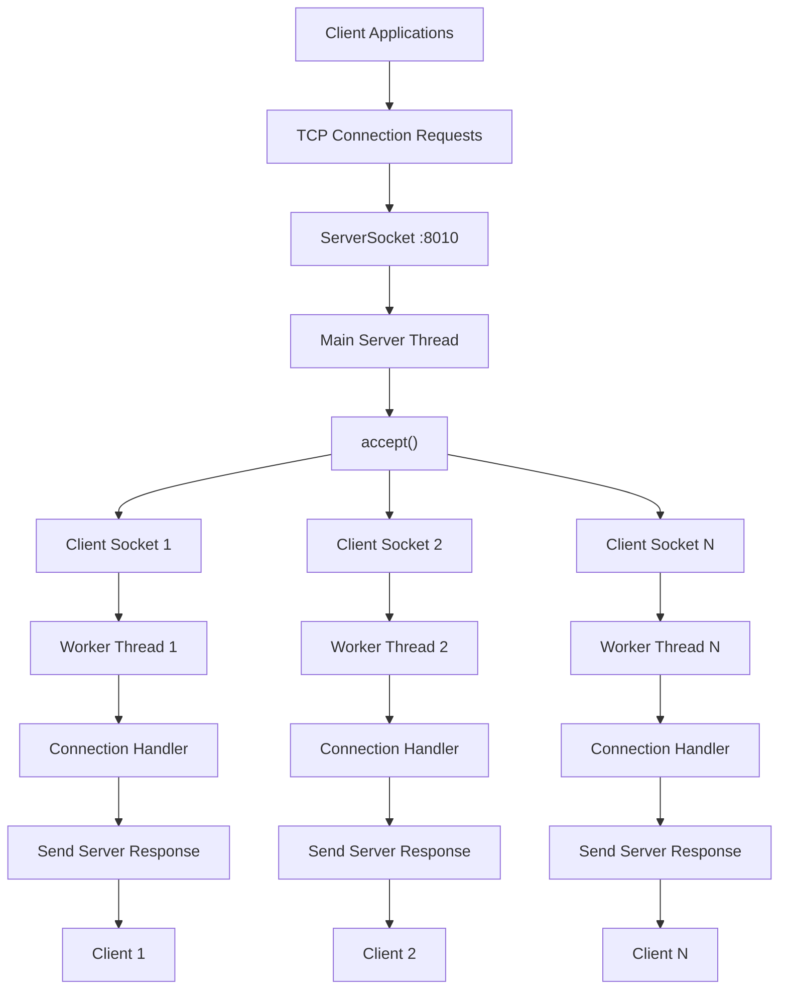
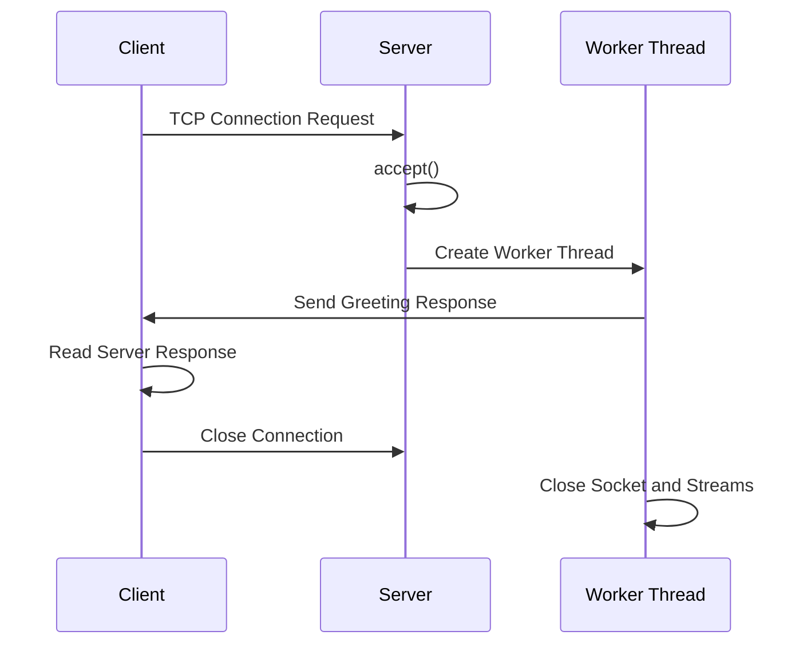
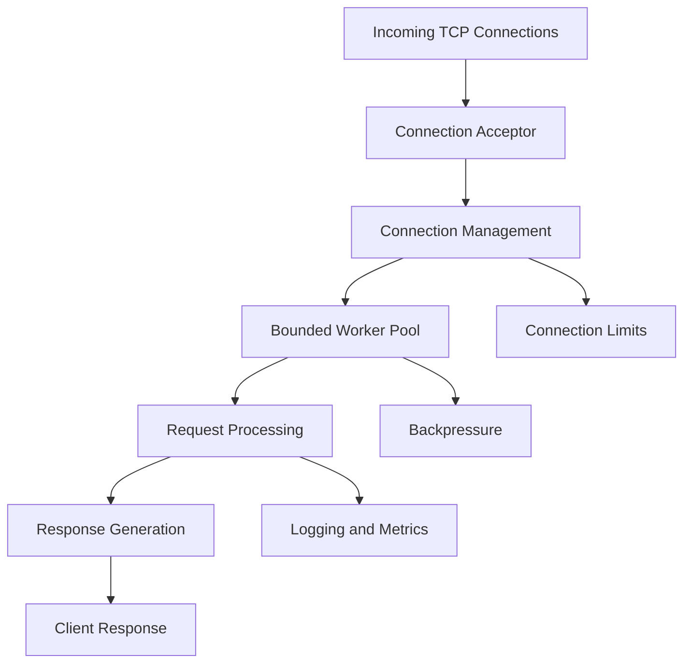

# ⚡ Multithreaded TCP Server in Java

### A Low-Level Networking & Concurrent Connection Handling Project

<p align="center">
  
  
  
  
</p>

<p align="center">
  <b>Built from scratch using Core Java, Java Threads, TCP Sockets, and Apache JMeter.</b>
</p>

---

## 📌 Overview

**Multithreaded TCP Server** is a low-level networking project developed using Core Java to understand how servers establish network connections, handle multiple clients, manage concurrent execution, and communicate over TCP.

Instead of relying on frameworks such as Spring Boot, Netty, or application servers, this project uses Java's built-in networking and concurrency APIs to implement the connection-handling mechanism from the ground up.

The server listens for incoming TCP connections on port `8010`. Whenever a client establishes a connection, the server accepts the connection and creates a dedicated worker thread to handle that client independently.

A separate multithreaded client simulator generates concurrent connections, while Apache JMeter is used to evaluate the server under load.

### 🎯 Primary Objectives

- Understand TCP client-server communication at the socket level.
- Implement concurrent connection handling using Java multithreading.
- Explore how operating systems and Java manage multiple network connections.
- Understand thread-per-connection architecture.
- Practice safe resource management and exception handling.
- Evaluate server performance using load testing and benchmarking.
- Develop a foundation for understanding scalable backend and distributed systems.

---

## 🏗️ System Architecture

The application follows a **Thread-per-Connection architecture**.

Each incoming client connection is accepted by the main server thread and delegated to an independent worker thread.

### Architecture Diagram



### Architecture Components

| Component | Responsibility |
|---|---|
| Client | Initiates TCP connections |
| ServerSocket | Listens for incoming connections |
| Main Server Thread | Accepts incoming connections |
| Socket | Represents an established client-server connection |
| Worker Thread | Handles an individual client connection |
| Consumer | Encapsulates the connection-handling logic |
| PrintWriter | Sends text-based responses to clients |
| Apache JMeter | Generates load and measures performance |

---

## 🔄 How the Server Works Internally

Understanding the complete lifecycle of a connection is essential to understanding this project.

### 1. Server Initialization

The server creates a `ServerSocket` bound to port `8010`.

```java
ServerSocket serverSocket = new ServerSocket(8010);
```

**What is ServerSocket?**

`ServerSocket` is a Java networking class that allows a server to listen for incoming TCP connection requests.

It acts as the entry point for client connections.

When a client connects, the server can accept that connection and obtain a corresponding `Socket` object.

### 2. Listening for Connections

```java
while (true) {
    Socket clientSocket = serverSocket.accept();
}
```

The server continuously listens for incoming connections.

**What does accept() do?**

- Waits for an incoming TCP connection.
- Blocks the calling thread until a connection is established.
- Returns a new `Socket` representing the connected client.
- Allows the server to communicate with that particular client.

This is called a blocking I/O operation.

The important distinction is that `accept()` waits for a connection, but it does not prevent already-created worker threads from handling their clients.

### 3. Creating Worker Threads

```java
Thread thread = new Thread(
    () -> server.getConsumer().accept(clientSocket)
);

thread.start();
```

Once a connection is accepted, the server creates a new worker thread.

Each worker thread handles its own client connection.

**Why multithreading?**

Consider a server receiving three client connections:

- Client A establishes a connection.
- Client B establishes a connection.
- Client C establishes a connection.

With a single-threaded blocking handler, one slow client could delay the processing of subsequent clients.

With this implementation, each client is assigned a separate worker thread, allowing their connection handlers to execute concurrently.

### 4. Connection Handling Using Consumer

```java
public Consumer<Socket> getConsumer() {
    return (clientSocket) -> {
        try (
            Socket socket = clientSocket;
            PrintWriter toSocket =
                new PrintWriter(socket.getOutputStream(), true)
        ) {
            toSocket.println(
                "Hello from server " + socket.getInetAddress()
            );

        } catch (IOException ex) {
            System.err.println(
                "Client handler exception: " + ex.getMessage()
            );
        }
    };
}
```

The `Consumer<Socket>` interface represents an operation that accepts a Socket and performs an action without returning a result.

Here, a lambda expression implements that operation.

The connection handler:

1. Receives the connected client socket.
2. Obtains the socket's output stream.
3. Wraps the output stream inside a `PrintWriter`.
4. Sends a greeting response to the client.
5. Closes the resources automatically.

### 5. Resource Management

The project uses Java's `try-with-resources` statement.

```java
try (
    Socket socket = clientSocket;
    PrintWriter writer =
        new PrintWriter(socket.getOutputStream(), true)
) {
    writer.println("Hello from server");
}
```

**Why is this important?**

Network sockets and streams consume system resources.

If they are not closed properly, they may cause resource leaks.

Try-with-resources automatically closes resources when execution leaves the block, including when an exception occurs.

This improves resource safety and makes connection handling more reliable.

---

## 🌐 Networking Concepts Used

This project provides practical exposure to several important networking concepts.

| Concept | Explanation |
|---|---|
| TCP | A connection-oriented transport protocol that provides reliable, ordered byte-stream delivery |
| IP Address | Identifies a host on an IP network |
| Port | Identifies a communication endpoint on a host |
| Socket | Endpoint used for communication between two networked processes |
| ServerSocket | Listens for incoming TCP connections |
| accept() | Waits for and accepts an incoming connection |
| Blocking I/O | An operation that waits until the required I/O event occurs |
| InputStream | Reads incoming bytes |
| OutputStream | Writes outgoing bytes |
| Connection Lifecycle | Establishment, communication, and termination of a connection |

### TCP Connection Lifecycle



**Important:** TCP provides a reliable byte stream, not message boundaries. This implementation sends a newline-terminated text response, which the client reads using `readLine()`.

---

## 🧵 Concurrency and Multithreading

One of the main learning objectives of this project is understanding how multiple client connections can be handled concurrently.

### Thread-per-Connection Model

The implementation follows this approach:

```text
Incoming Connection
        |
        v
   Accept Connection
        |
        v
  Create New Thread
        |
        v
  Handle Client Request
        |
        v
  Close Connection
```

Each connection gets its own worker thread.

### Benefits

- Independent client handling.
- Concurrent execution of connection handlers.
- Simpler connection isolation.
- Blocking operations in one worker do not directly block other workers.

### Trade-offs

Creating one thread per connection is straightforward, but it introduces scalability limitations.

Every thread consumes memory and operating-system scheduling resources.

For a very large number of concurrent connections, unrestricted thread creation can result in:

- Increased memory consumption.
- Context-switching overhead.
- Thread scheduling contention.
- Resource exhaustion.
- Reduced performance under extreme concurrency.

### Possible Improvements

A more scalable architecture could use:

1. **Thread Pool:** Reuse a bounded number of worker threads.
2. **ExecutorService:** Manage task execution and thread lifecycle.
3. **Backpressure:** Control incoming work when the server reaches capacity.
4. **Non-blocking I/O:** Use Java NIO and Selector for event-driven connection management.
5. **Connection Limits:** Restrict the number of simultaneously accepted connections.

These are potential improvements, not features of the current implementation.

---

## 🖥️ Multithreaded Client Simulator

The project includes `Client.java`, which simulates multiple clients connecting to the server.

```java
public static void main(String[] args) {

    Client client = new Client();

    int clientCount = 100;

    System.out.println(
        "[+] Launching " + clientCount +
        " parallel client threads..."
    );

    for (int i = 0; i < clientCount; i++) {

        Thread thread =
            new Thread(client.getRunnable());

        thread.start();
    }
}
```

### Execution Flow

1. The client simulator initializes 100 threads.
2. Each thread creates a TCP socket.
3. Each socket connects to `localhost:8010`.
4. The client sends a greeting message.
5. The client waits for the server's response.
6. The response is displayed in the console.
7. The socket and associated streams are closed.

This provides a practical demonstration of concurrent client connections.

---

## 📊 Performance Testing and Benchmarking

To evaluate server behavior under load, Apache JMeter was used.

JMeter is a load-testing tool that can generate concurrent requests and collect performance measurements.

### Recorded Benchmark Results

| Performance Metric | Recorded Result |
|---|---:|
| Peak Throughput | 23,180+ requests/sec |
| Total Requests Handled | 1,024,287+ |
| Average Response Latency | 15 ms |
| Minimum Response Latency | 0 ms |
| Reported Error Rate | 0.00% |

**Note:** These are recorded results from the project's existing benchmark. Actual performance depends on hardware, operating system, JVM configuration, JMeter settings, network conditions, and test methodology. The figures should not be interpreted as guaranteed production capacity.

### Understanding the Metrics

**1. Throughput**

Throughput represents how many requests or operations are processed within a given period.

For example:

```text
Throughput = 10,000 requests/second
```

This means the measured system processes approximately 10,000 requests every second during that measurement interval.

**2. Latency**

Latency measures the time taken to complete an operation from the perspective of the measurement tool.

Lower latency generally indicates faster response times.

**3. Error Rate**

The percentage of requests that fail during a test.

```text
Error Rate =
(Failed Requests / Total Requests) × 100
```

**4. Concurrent Connections**

The number of client connections active at the same time.

Concurrency and throughput are related, but they are not the same metric.

A system can have many concurrent connections without completing the same number of requests per second.

### Running JMeter Tests

Command-line execution:

```bash
jmeter -n -t web_server_testing.jmx -l test_results.jtl
```

GUI execution:

```bash
jmeter -t web_server_testing.jmx
```

Useful JMeter listeners include:

- Aggregate Report
- Summary Report
- View Results Tree
- View Results in Table

For repeatable benchmarking, document the machine specifications, JVM version, JMeter thread-group configuration, ramp-up period, test duration, and number of iterations.

---

## ⚙️ Technology Stack

| Technology | Purpose |
|---|---|
| Java 17+ | Core programming language |
| Java Threads | Concurrent execution |
| `ServerSocket` | TCP server-side connection listening |
| `Socket` | Client-server communication |
| Java I/O | Stream-based communication |
| Lambda Expressions | Functional connection-handler implementation |
| `Consumer<Socket>` | Encapsulation of connection-handling logic |
| Try-with-resources | Automatic resource management |
| Apache JMeter | Load testing and performance analysis |

No Spring Boot, Netty, or external web-server framework is required.

---

## 📁 Project Structure

```text
Multithreaded-web-server/
│
├── Server.java
│   └── TCP server, connection listener,
│       worker thread creation and response handling
│
├── Client.java
│   └── Multithreaded client simulator
│
├── web_server_testing.jmx
│   └── Apache JMeter test configuration
│
├── Thread Group.jmx
│   └── Additional JMeter thread-group test plan
│
├── .gitignore
│   └── Git ignore configuration
│
└── README.md
    └── Project documentation
```

---

## 🚀 Getting Started

### Prerequisites

- JDK 17 or higher.
- Git.
- Apache JMeter 5.6.3 or higher (optional, for load testing).

### 1. Clone the Repository

```bash
git clone https://github.com/Mayank1036/Multithreaded-web-server.git

cd Multithreaded-web-server
```

### 2. Compile the Java Files

```bash
javac Server.java Client.java
```

### 3. Start the Server

```bash
java Server
```

Expected output:

```text
[+] Server successfully listening on port 8010
[+] Awaiting incoming connections...
```

### 4. Start the Client Simulator

Open another terminal in the project directory.

```bash
java Client
```

Expected client output:

```text
[+] Launching 100 parallel client threads...
[Client Thread] Server response: Hello from server ...
```

### 5. Run Performance Tests

With the server running, execute:

```bash
jmeter -n -t web_server_testing.jmx -l test_results.jtl
```

---

## ⚠️ Current Scope and Limitations

This project focuses on TCP socket programming and concurrent connection handling. It is not intended to be a production-ready HTTP server.

Current limitations:

- No HTTP request parsing or HTTP status codes.
- No request routing or REST API endpoints.
- One dedicated thread is created per accepted connection.
- No bounded thread pool or admission control.
- No connection timeout or idle-connection management.
- No application-level authentication or authorization.
- No structured logging or monitoring system.
- No graceful shutdown mechanism beyond normal process termination.

Understanding these limitations is part of understanding the design and its trade-offs.

---

## 🔮 Future Enhancements

The following improvements can evolve this project into a more scalable networking system:

| Enhancement | Learning Objective |
|---|---|
| Thread Pool using ExecutorService | Controlled concurrency and thread reuse |
| Java NIO | Non-blocking networking |
| Selector API | Event-driven connection management |
| HTTP/1.1 Parsing | HTTP protocol fundamentals |
| Connection Timeout | Resource lifecycle management |
| Graceful Shutdown | Reliable server termination |
| Structured Logging | Production observability |
| Metrics Collection | Performance monitoring |
| Backpressure | Overload management |
| Docker Support | Containerization and deployment |

### Potential Architectural Evolution



This diagram represents a proposed future architecture, not the current implementation.

---

## 🧠 Key Engineering Concepts Demonstrated

By building this project, the following concepts were explored:

- TCP/IP networking fundamentals.
- Client-server architecture.
- Socket programming in Java.
- Blocking I/O operations.
- Thread-per-connection concurrency model.
- Thread lifecycle and independent execution.
- Java functional interfaces.
- Lambda expressions.
- Exception handling in network applications.
- Automatic resource management.
- Load testing and performance benchmarking.
- Throughput, latency, and error-rate analysis.
- Scalability trade-offs in concurrent systems.

---

## 👨‍💻 Author

**Mayank Saini**

B.Tech Computer Science Engineering | Artificial Intelligence & Data Science

Interested in Backend Engineering, Computer Networks, Distributed Systems, and High-Performance Software.

- GitHub: https://github.com/Mayank1036
- LinkedIn: https://www.linkedin.com/in/mayank-saini-4860a4210/

---

⭐ If you find this project useful for understanding Java networking and multithreaded server architecture, consider giving the repository a star.

